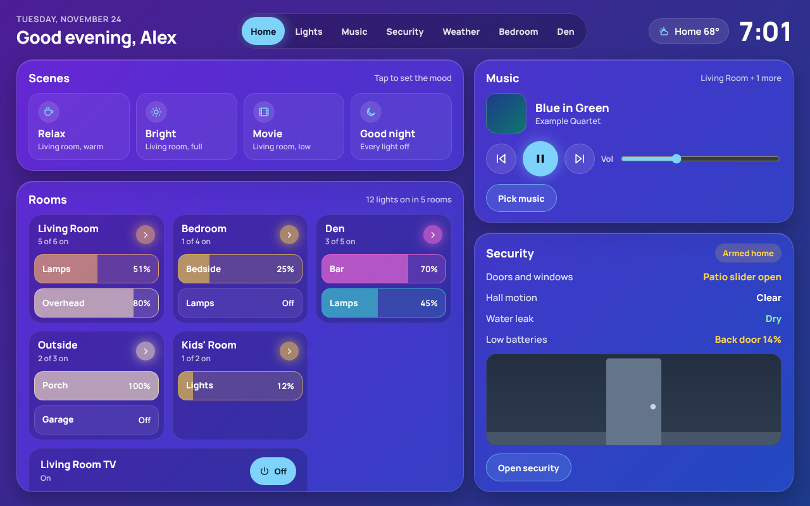

# Glass Wall Panel

A full-screen, liquid-glass Home Assistant dashboard for wall tablets. One JavaScript file, no build step, no other custom cards required. You describe your home in YAML and it draws the tabs.

Built on a Fire HD 10, then generalized. Ships with three device profiles:

| Device | `device:` | Example config |
|---|---|---|
| Fire HD 10 (and most 10 to 11 inch Android tablets) | `fire10` | [examples/fire-hd-10.yaml](examples/fire-hd-10.yaml) |
| Fire HD 8 (and 7 to 9 inch Android tablets) | `fire8` | [examples/fire-hd-8.yaml](examples/fire-hd-8.yaml) |
| iPad, any size | `ipad` | [examples/ipad.yaml](examples/ipad.yaml) |

Leave it on `device: auto` and the card picks one. Under 900 px wide (a phone) it switches to a single scrolling column by itself.

## What you get

- **Home**: scene buttons, every room with dimmable light bars, now playing, security at a glance
- **Lights**: every light by room
- **Music**: speaker list with join and leave grouping, plus a Music Assistant library browser and search
- **Security**: arm and disarm, door, motion and leak sensors, camera, battery levels
- **Weather**: current conditions, next hours, the week, live radar centered on your home
- **Room pages**: any room can get its own tab with lights, scenes, a speaker and a TV remote

Light gestures work like the Hue app: tap for on and off, press and slide to dim, hold a single light for color and white temperature.

It works with whatever is in Home Assistant: any `light`, `scene`, `media_player`, `alarm_control_panel`, `camera`, `binary_sensor` and `weather` entity. Hue, Ring, Spotify through Music Assistant and Samsung TVs are what it was built against, none of them are required.

## Install

A prettier version of these steps lives in [index.html](index.html).

**1. Get the file.** Download [`dist/glass-wall-panel.js`](dist/glass-wall-panel.js).

**2. Put it in Home Assistant.** Copy it to the `www` folder inside your Home Assistant config folder, so it sits at `/config/www/glass-wall-panel.js`. The File editor, Samba or Studio Code Server add-ons all work. Create `www` if it is not there, then restart Home Assistant once so it notices the new folder.

**3. Register it.** Settings → Dashboards → three-dot menu → Resources → Add resource.
URL: `/local/glass-wall-panel.js?v=3.0.0`, type: JavaScript module.

**4. Make a dashboard.** Settings → Dashboards → Add dashboard → New dashboard from scratch. Call it Wall Panel.

**5. Paste a config.** Open the new dashboard → pencil → three-dot menu → Raw configuration editor. Replace everything with the example file for your tablet from [`examples/`](examples).

**6. Swap in your entities.** Replace each `light.…`, `media_player.…` and so on with your own ids. Find them under Developer tools → States. Delete any section you do not own. Save.

**7. Open it on the tablet.** Go to `http://homeassistant.local:8123/wall-panel/home` in a kiosk browser or the Home Assistant app. Add `?edit=1` to the URL any time you need Home Assistant's header back.

HACS users can skip steps 1 to 3: HACS → three-dot menu → Custom repositories → paste this repository's URL, type Dashboard, then install Glass Wall Panel.

## Let an AI set it up

[`LLM_SETUP.md`](LLM_SETUP.md) is written for Claude, ChatGPT or any other assistant. Give it that file, tell it which tablet you have, and it will ask for your entities and hand back a finished config.

## Config reference

Everything except `type` is optional. Sections you leave out do not get a tab.

| Key | What it does |
|---|---|
| `device` | `auto`, `fire10`, `fire8` or `ipad` |
| `name` | Name used in the greeting |
| `accent` | Highlight color, hex. Default `#7dd3fc` |
| `background` | List of 2 or more hex colors for the backdrop gradient |
| `blur` | Glass blur in px. Default 14 |
| `lite` | `true` drops the blur for slow tablets |
| `animate` | `true` slowly drifts the backdrop. Off by default to spare the tablet |
| `hide_header` | Hide Home Assistant's top bar on this dashboard. Default `true` |
| `idle_seconds` | Return to Home after this long. Default 120, `0` disables |
| `scenes` | Home tab buttons: `name`, `entity` (or `all_off`), `note`, `icon` (`sun`, `cup`, `film`, `moon`) |
| `rooms` | `name`, `groups` (each `name` + `lights`) or a flat `lights` list, `page`, `speaker`, `scenes` |
| `music` | `speakers`, `default`, `library` (`false` without Music Assistant), `config_entry_id` |
| `security` | `alarm`, `title`, `modes`, `code`, `camera`, `camera_name`, `sensors` (`type`: `door`, `window`, `motion`, `leak`), `batteries`, `low_battery` |
| `weather` | `entity`, `location_name`, `radar` (`true`, `false`, or `lat`/`lon`/`zoom`) |
| `tvs` | `entity`, `name`, `home`, `room`, `apps` (`name`, `id`, `color`), `app_type` |

The full annotated version is in [examples/fire-hd-10.yaml](examples/fire-hd-10.yaml).

## Good to know

- The radar is an embedded Windy map and the font is loaded from Google Fonts, so those two need internet. Everything else is local.
- `security.code` is stored in plain text in the dashboard config. Only use it if your alarm needs a code and you accept that.
- If the Music tab says it cannot reach Music Assistant, add `config_entry_id` under `music`. It is the long id at the end of the URL when you open the Music Assistant integration's page in Settings.
- Fire tablets feel best with `animate` left off. If one still lags, try `lite: true`.
- Try it without Home Assistant: open [`demo/index.html`](demo/index.html) through any local web server. It runs against a fake house.

## License

MIT. Use it, change it, ship it on your wall.
